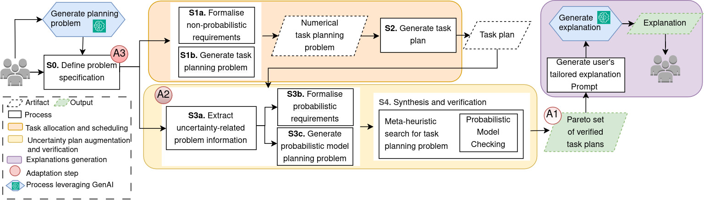
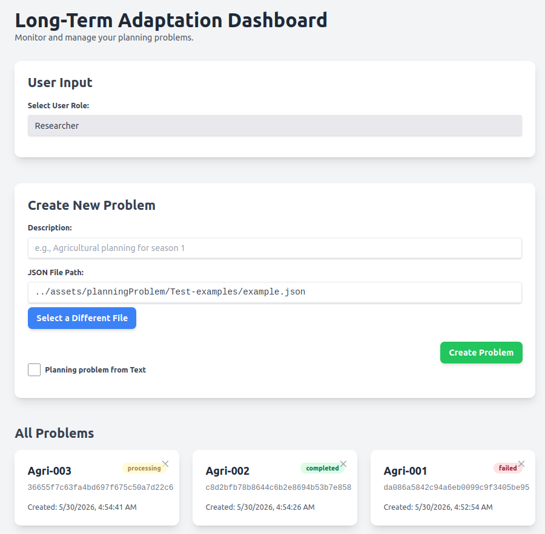
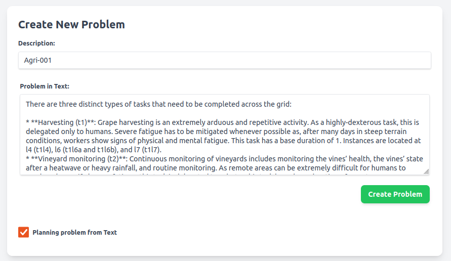
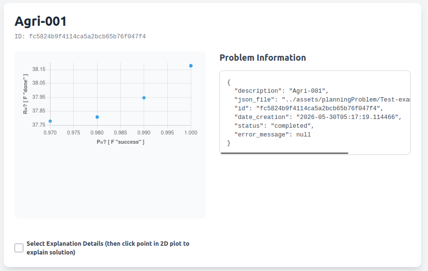
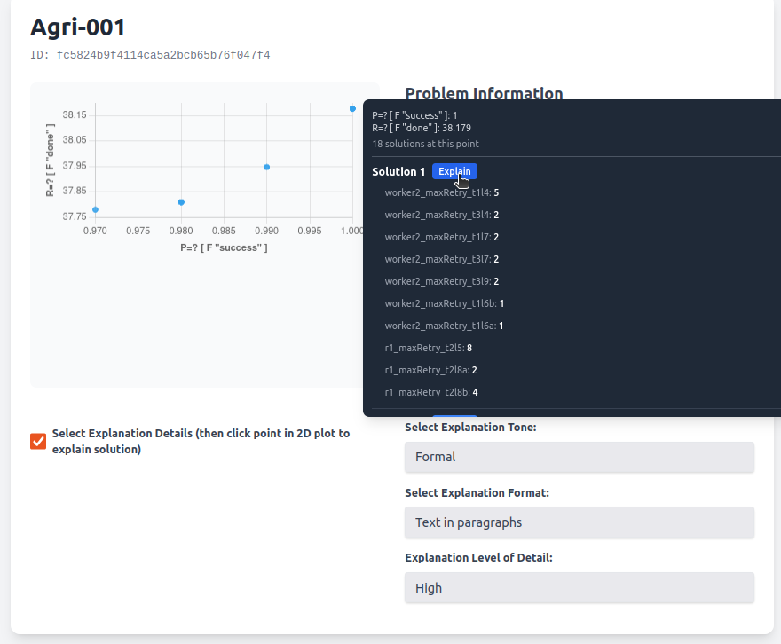
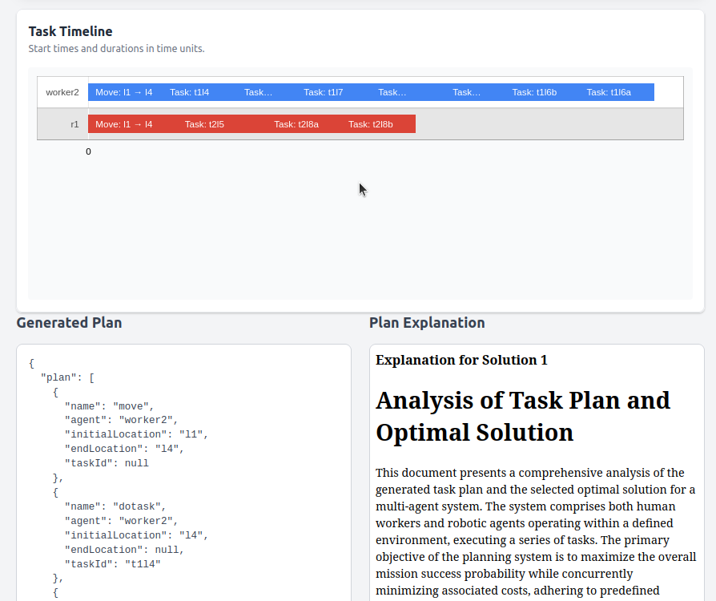
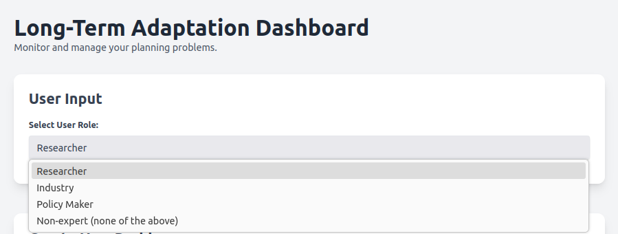
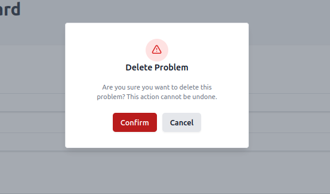
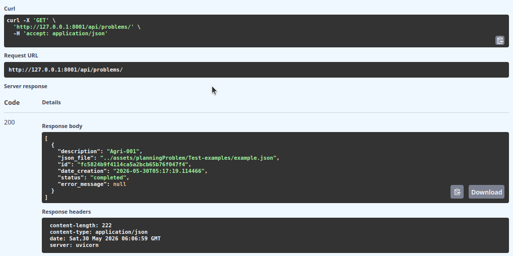

# ARCH (Adaptive Robot–Human Collaboration using Hybrid Planning)

## Abstract

ARCH is a framework for the synthesis of verified task plans, adaptation of plans after deployment, and the generation of adaptive plan explanations.

ARCH uses a hybrid approach that effectively solves the task planning problem by decomposing it into two intertwined parts, starting with the identification of a feasible (deterministic) plans and followed by its uncertainty augmentation and verification yielding a set of Pareto optimal plans. To enhance its robustness, adaptation tactics are devised for the evolving system requirements and agent’s capabilities. ARCH can generate explanations for a generated plan tailored to user preferences of tone, format and level of detail, as well as the user profile. 




## 1 Install and Run ARCH hybrid planner

Install and run ARCH Docker or locally.


### 1.1 Using Docker 

Refer to [README-Docker](README-Docker.md) for instructions to create and run ARCH as a Docker container. Skip the next steps until ARCH UI. 


### 1.2 Local installation

#### Install ARCH locally

From the root of the project, run:
```
chmod +x run.sh
./run.sh
```
This is the only step needed. ```run.sh``` only installs; it does not start the planner. It:
- checks that Java 17 or newer is available (and installs it if not),
- creates the python environment ```.venv``` at the root of the project (Python 3.10 or newer),
- installs the TemPEST solver, and ARCH with its dependencies (declared in [pyproject.toml](pyproject.toml)),
- downloads [EvoChecker](https://github.com/gerasimou/EvoChecker/tree/evoCheckerJar) into ```apps/EvoChecker```. To use an EvoChecker installed somewhere else, set the environment variable ```ARCH_EVOCHECKER_DIR``` to the folder containing ```EvoChecker-1.1.0.jar``` and its ```libs``` folder.

It can be run again at any time, e.g., after changing the dependencies in ```pyproject.toml```.

#### Run ARCH locally

There are two Jupyter notebooks. For both, select the ```.venv``` environment as kernel and run the cells.
- [run_planner_ui.ipynb](run_planner_ui.ipynb) starts the Rest API and the web app. Interrupt the cell to stop them.
- [run_planner.ipynb](run_planner.ipynb) runs the planner directly from Python on a JSON planning problem, without the Rest API or the web app, and reads the plan and the Pareto front. Its last section injects task retries into the plan and checks with CPMpy whether the mission constraints (ordering of tasks, maximum duration) still hold, showing the Gantt charts before and after.


## 2 ARCH UI

The API and **web app** will be running locally at **```http://localhost:8001```** (port 8001 defined in run_planner_ui.ipynb).

Note: To test and submit a planning problem directly through the API try ```http://localhost:8001/docs``` instead. For documentation on how FastAPI works, go to [FastAPI](https://fastapi.tiangolo.com/tutorial/first-steps/#interactive-api-docs).

## Interacting with web app

The web app allows you to submit and manage multiple planning problems.

Launch a new planning problem by setting a description and the path to the JSON file. Press Create Problem.

The planning problem can also be defined in natural language. This automatically creates a JSON file.


Check the Pareto front results when a planning problem is completed.



Generate an explanation by selecting one of the solutions in the Pareto front. Change the user preferences at the bottom as desired. 



Generate an explanation for a selected solution from the Pareto front. User preferences can be customised at the bottom.



Explanations can also be tailored to different user profiles.




Delete a planning problem if needed.




## 3 Read output files

At completion, the hybrid planner generates data in the following locations depending on the planning problem input:

- From **JSON**: creates a folder at the same path as the input .JSON file ```output_{name_of_JSON_file}_{problem_random_id}```
- From **natural language**: creates a folder at ```/output/temp/output_generated_problem_{json_random_id}{problem_random_id}```

The folder contains:
- Data from numerical planner: PDDL files, plan, EvoChecker files, execution times per run
- Data from uncertainty augmentation: Pareto front and set obtained per run, execution times per run

## 4 Interact with ARCH

Interact with ARCH using **curl**. For available endpoints see ```http://127.0.0.1:8001/docs```.

For example, when a new planning problem is added, ARCH RestAPI create a new problem accesible at ```http://127.0.0.1:8001/api/problems/``` using ```curl -X 'GET'```. In this example, only one problem Agri-001 is available in the database: 




For more information see https://www.geeksforgeeks.org/linux-unix/using-curl-to-make-rest-api-requests/


## 5 Configuration

To configure the EvoChecker settings **modify** ```config.ini``` file parameters of population size and iterations as needed. 


**Enjoy!**


# ------- Q&A ------------

This section contains some possible errors that might be encountered during installation and how to solve them.

### 1 Error when installing the python environment.
If the python environment initialisation fails because of a newer release of a dependency, pin the versions ARCH was tested with by replacing the corresponding entries of `dependencies` in ```pyproject.toml``` with:
```
"fastapi[standard]==0.116.1",
"unified-planning==1.2.0",
"up-aries==0.4.0",
"up-enhsp==0.0.27",
"up-fmap==0.0.13",
"up-pyperplan==1.1.0",
"up-symk==1.3.1",
"matplotlib==3.7.3",
"numpy==1.26.4",
```
and running ```pip install -e .``` again.

### 2 ERROR: pip's dependencies when creating the virtual environment
This error can be ignored:
```
ERROR: pip's dependency resolver does not currently take into account all the packages that are installed. This behaviour is the source of the following dependency conflicts.
generate-parameter-library-py 0.4.0 requires jinja2, which is not installed.
generate-parameter-library-py 0.4.0 requires typeguard, which is not installed.
```


### 3 Error: ModuleNotFoundError: No module named 'tempest' (detailed)

The TempEST solver library has not been installed (or the python environment has not been configured properly). To install the TempEST solver library, first activate the python environment:
```
source .venv/bin/activate
```
TemPEST relies on [PySMT](https://github.com/pysmt/pysmt) to interface with SMT/OMT solvers. You must install PySMT and at least one solver (e.g., Z3):
```
pip3 install --pre pysmt
pysmt-install --z3
```
Then install TemPEST from the following directory:
```
pip install ./apps/tempest
```
Finally, deactivate the python env: 
```
deactivate
```
and try running ARCH again.
